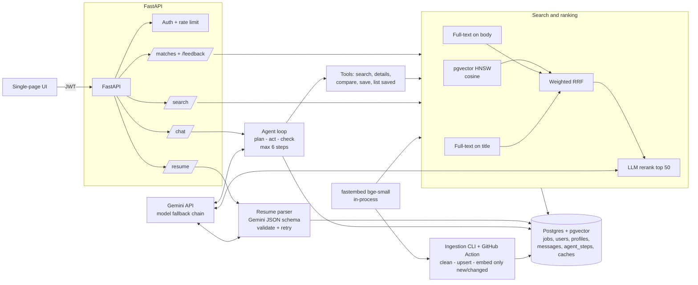

# JobMatch Agent

An AI career agent in miniature: **upload a resume → get personalised matches from a live jobs index → chat with an agent that searches, compares and saves jobs.** Built as a portfolio project mirroring what an AI job-search product needs: LLM agents with tools and memory, structured outputs, hybrid retrieval + reranking + personalisation, an incrementally updated index, and an honest evaluation suite.

**Live demo:** _<!-- LIVE_URL -->_ (Render free tier: the first request after idle takes ~30-60 s to wake)

| | |
|---|---|
| Backend | Python 3.11, FastAPI (async), SQLAlchemy 2.0 async, Alembic |
| Data | Postgres + pgvector (Neon free tier): HNSW vector index + GIN full-text indexes |
| LLM | Gemini API (free tier): function calling, JSON-schema output, reranking, explanations |
| Embeddings | `BAAI/bge-small-en-v1.5` (384-d) via fastembed/ONNX, runs in-process (see [why](#design-decisions--trade-offs)) |
| Quality | pytest (mocked LLM + real pgvector in CI), ruff, GitHub Actions, offline eval suite |
| Ship | Docker, docker-compose, Render blueprint |

## What it does

1. **Sign up / log in** (bcrypt + JWT, per-user data isolation).
2. **Upload a PDF resume** → Gemini returns JSON validated against a Pydantic schema (validate → retry with the error fed back → fail cleanly).
3. **Matches** → the profile becomes a query; hybrid retrieval + LLM rerank returns the top 10, each with a *why it matches* explanation, matched / missing skills and a fit score. 👍/👎 updates a per-user preference vector (Rocchio) that changes future rankings.
4. **Agent chat** → a hand-written plan → act → check loop over five tools (`search_jobs`, `get_job_details`, `compare_resume_to_job`, `save_job`, `list_saved_jobs`) with memory in Postgres, so follow-ups like *"only remote ones"* or *"compare the 2nd one with my resume"* work. The UI shows every tool call.
5. **A changing index** → `python cli.py ingest` (also a scheduled GitHub Action) adds new postings and embeds only new or changed rows.

## Architecture



## How the agent loop works

`app/services/agent.py` is ~100 lines of explicit control flow, no framework:

* **PLAN** – the model gets the system prompt, a context block loaded from Postgres (profile, saved jobs, the last search's position → `job_id` map and filters) and the last 12 messages. Its first turn states a one-line plan and emits tool calls, or answers directly.
* **ACT** – every call is validated against a Pydantic args model, run under a timeout, and any failure (bad args, unknown tool, missing job, timeout, crash) becomes an `{"error": ...}` *observation* instead of an exception.
* **CHECK** – a deterministic checker annotates each observation: tool failed / zero results (relax a filter) / duplicate call (stop repeating). The observation returns to the model, which continues or answers.
* **LIMIT** – at most 6 model calls; the last has tools disabled, so the user always gets an answer.
* **OBSERVE** – every model call and tool call is written to `agent_steps` with latency and token usage, and returned to the UI.
* **Memory** – `messages` holds history plus conversational state (`last_query`, `last_filters`, `last_results`), which is what makes "the 2nd one" resolvable.

## Search and ranking pipeline

1. **Three retrievers** (each top 100, all honouring location / remote / recency filters):
   pgvector cosine (HNSW) · Postgres full-text on title + description (`ts_rank_cd`) · full-text on the title only. Queries become OR-tsqueries so long natural-language queries still match.
2. **Weighted Reciprocal Rank Fusion** (`score = Σ wᵣ / (60 + rankᵣ)`, weights 1 : 0.5 : 0.5).
3. **LLM rerank of the top 50** (one JSON-schema call, cached by query + candidates, falls back to the RRF order on any failure).
4. **Personalisation** (matches): query vector = normalise(α·profile + β·mean(liked) − γ·mean(disliked)), recomputed from all feedback each time; disliked jobs are excluded.

<!-- EVAL_RESULTS -->

## Run it locally

```bash
python -m venv .venv && . .venv/bin/activate        # Windows: .venv\Scripts\activate
pip install -r requirements-dev.txt -r requirements-ingest.txt
cp .env.example .env                                  # fill GEMINI_API_KEY, DATABASE_URL, JWT_SECRET
docker compose up -d db                               # or use a Neon connection string
alembic upgrade head
python cli.py fetch && python cli.py ingest --add 5000   # download sample, clean, embed (a few minutes)
uvicorn app.main:app --reload                         # http://localhost:8000
pytest -q                                             # LLM is mocked; DB tests need TEST_DATABASE_URL
python -m evals.run                                   # full eval suite -> evals/RESULTS.md
```

## Deploy (Render free + Neon free)

1. Create a Neon project, copy the connection string.
2. Render → New → Blueprint → select this repo (`render.yaml`).
3. Set `DATABASE_URL` and `GEMINI_API_KEY`; deploy. The container runs `alembic upgrade head` and then serves.
4. For the scheduled ingestion workflow add repo secrets `DATABASE_URL` and `GEMINI_API_KEY`.

## Data

Postings come from the public Hugging Face dataset [`datastax/linkedin_job_listings`](https://huggingface.co/datasets/datastax/linkedin_job_listings) (real LinkedIn postings, Apr 2024, with full descriptions, locations, remote flags, timestamps). I chose it over `lukebarousse/data_jobs` (no descriptions) and sampled the first ~60 MB of the 517 MB CSV (13.9k clean postings after dedupe), loading 5,000. Cleaning: strip HTML, drop <200-char descriptions, dedupe on title+company+location, lexicon-based skill extraction. Arrival order is a deterministic shuffle so the incremental job simulates a feed.

## Design decisions & trade-offs

* **Local embeddings instead of Gemini embeddings.** On this key's free tier `gemini-embedding-001` allows 1,000 texts per *day* and every search query costs one, so a 5,000-posting index and live search were impossible. The embedder is a pluggable provider (`EMBED_PROVIDER=local|gemini`); local bge-small is free, unlimited, ~250 MB RAM, and fits Render's 512 MB. Trade-off: a 384-d general model, not a 3072-d frontier one.
* **A Gemini model fallback chain.** Free-tier quotas are per model and tiny (one Flash model allowed 20 requests/day). `GeminiLLM` walks an ordered chain, parks a model on a daily-quota 429 until it resets, retries without `thinking_budget` on models that reject it, and respects a per-minute limiter.
* **LLM rerank rather than a cross-encoder.** A local cross-encoder needs torch (~1 GB image) which does not fit free hosting; one pointwise JSON call over 50 candidates is cheap, cached and fails open.
* **Hand-written agent loop** over a framework: every step is inspectable, testable with a scripted fake LLM, and the step limit / validation / recovery behaviour is explicit.
* **Weighted RRF** over score blending: rank-based fusion needs no score calibration between BM25-style and cosine scores; weights were chosen on a dev split of the golden queries and verified on a held-out split.
* **Rocchio feedback recomputed, not accumulated**, so changing a like to a dislike is exact and there is no drift.
* **Deterministic missing-skills.** Skill gaps come from the lexicon, not the LLM, so they cannot be hallucinated; the LLM only writes the explanation and fit score.
* **In-memory rate limiter**: correct for one instance (this deployment); with several instances it must move to Redis/Postgres.

## Limitations and future work

* Golden-set labels come from explicit title rubrics, not human reading of every posting, and title-only rubrics favour title-matching retrievers.
* The LLM judge is the same model family as the generator, so scores are optimistic.
* Skills are a ~110-term lexicon, not a learned taxonomy; resumes must be text PDFs (no OCR).
* Free-tier Gemini quotas cap how many users the live demo can serve per day.
* Next: cross-encoder rerank on a paid host, learned fusion weights, OCR for scanned resumes, Redis rate limiting, per-user saved searches and alerts, evals in CI on a nightly schedule.
