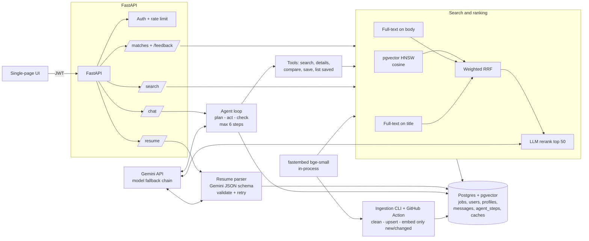

# JobMatch Agent

An AI career agent in miniature: **upload a resume → get personalised matches from a live jobs index → chat with an agent that searches, compares and saves jobs.** Built as a portfolio project mirroring what an AI job-search product needs: LLM agents with tools and memory, structured outputs, hybrid retrieval + reranking + personalisation, an incrementally updated index, and an honest evaluation suite.

**Live demo:** **https://jobmatch-agent-ysjr.onrender.com** (Render free tier: the first request after idle takes ~30-60 s to wake)

| | |
|---|---|
| Backend | Python 3.11, FastAPI (async), SQLAlchemy 2.0 async, Alembic |
| Data | Postgres + pgvector (Neon free tier): HNSW vector index + GIN full-text indexes |
| LLM | Gemini API (free tier): function calling, JSON-schema output, reranking, explanations |
| Embeddings | `BAAI/bge-small-en-v1.5` (384-d) via fastembed/ONNX, runs in-process (see [why](#design-decisions--trade-offs)) |
| Frontend | Landing page plus signed in app: plain HTML, CSS and JS served by FastAPI, no build step. Instrument Serif, Manrope, JetBrains Mono, Phosphor icons. Interactive demos use real data from the index and real agent runs (`python scripts/build_demo.py` regenerates `app/static/demo/`) |
| Quality | pytest (mocked LLM + real pgvector in CI), ruff, GitHub Actions, offline eval suite |
| Ship | Docker, docker-compose, Render blueprint |

## What it does

1. **Sign up / log in** (bcrypt + JWT, per-user data isolation).
2. **Upload a PDF resume** → Gemini returns JSON validated against a Pydantic schema (validate → retry with the error fed back → fail cleanly).
3. **Matches** → the profile becomes a query; hybrid retrieval + LLM rerank returns the top 10, each with a *why it matches* explanation, matched / missing skills and a fit score. 👍/👎 updates a per-user preference vector (Rocchio) that changes future rankings.
4. **Agent chat** → a hand-written plan → act → check loop over five tools (`search_jobs`, `get_job_details`, `compare_resume_to_job`, `save_job`, `list_saved_jobs`) with memory in Postgres, so follow-ups like *"only remote ones"* or *"compare the 2nd one with my resume"* work. The UI shows every tool call.
5. **A changing index** → `python cli.py ingest` (also a scheduled GitHub Action) adds new postings and embeds only new or changed rows.
6. **Open jobs with apply links** → every job you see is open right now and has an **Apply** button that opens the original listing. Closed and archived postings are never shown.

## Architecture



## How the agent loop works

`app/services/agent.py` is ~100 lines of explicit control flow, no framework:

* **PLAN** – the model gets the system prompt, a context block loaded from Postgres (profile, saved jobs, the last search's position → `job_id` map and filters) and the last 12 messages. Its first turn states a one-line plan and emits tool calls, or answers directly.
* **ACT** – every call is validated against a Pydantic args model, run under a timeout, and any failure (bad args, unknown tool, missing job, timeout, crash) becomes an `{"error": ...}` *observation* instead of an exception.
* **CHECK** – a deterministic checker annotates each observation: tool failed / zero results (relax a filter) / duplicate call (stop repeating). The observation returns to the model, which continues or answers.
* **LIMIT** – at most 6 model calls; the last has tools disabled, so the user always gets an answer.
* **OBSERVE** – every model call and tool call is written to `agent_steps` with latency and token usage, and returned to the UI.
* **Memory** – `messages` holds history plus conversational state (`last_query`, `last_filters`, `last_results`), which is what makes "the 2nd one" resolvable.

## Search and ranking pipeline

1. **Three retrievers** (each top 100, all honouring location / remote / recency filters):
   pgvector cosine (HNSW) · Postgres full-text on title + description (`ts_rank_cd`) · full-text on the title only. Queries become OR-tsqueries so long natural-language queries still match.
2. **Weighted Reciprocal Rank Fusion** (`score = Σ wᵣ / (60 + rankᵣ)`, weights 1 : 0.5 : 0.5).
3. **LLM rerank of the top 50** (one JSON-schema call, cached by query + candidates, falls back to the RRF order on any failure).
4. **Personalisation** (matches): query vector = normalise(α·profile + β·mean(liked) − γ·mean(disliked)), recomputed from all feedback each time; disliked jobs are excluded.

## Evaluation results

Every number is produced by `python -m evals.run` (raw JSON in `evals/results/`, full report in [`evals/RESULTS.md`](evals/RESULTS.md)); none are hand-entered.

### 1. Retrieval quality

43 golden queries over a frozen snapshot of 5,000 postings (labels from explicit title rubrics in `evals/golden_queries.py`, not from any retriever). recall@10 is capped: hits / min(#relevant, 10).

**Baseline** (run 2026-11-18T16:52:23+00:00)

| Retriever | recall@10 | MRR | nDCG@10 | mean latency |
|---|---|---|---|---|
| Vector only | 0.660 | 0.852 | 0.687 | 1487 ms |
| Full-text only (ts_rank_cd) | 0.493 | 0.593 | 0.481 | 630 ms |
| Hybrid (RRF) | 0.630 | 0.855 | 0.668 | 995 ms |

**After improvement** (run 2026-11-18T17:33:47+00:00)

| Retriever | recall@10 | MRR | nDCG@10 | mean latency |
|---|---|---|---|---|
| Vector only | 0.660 | 0.852 | 0.687 | 925 ms |
| Full-text only (ts_rank_cd) | 0.493 | 0.593 | 0.481 | 725 ms |
| Hybrid (RRF) | 0.712 | 0.858 | 0.731 | 1147 ms |
| Hybrid + LLM rerank (top 50) | 0.777 | 0.913 | 0.799 | 12232 ms |

**Before → after**

| Retriever | nDCG@10 | MRR | recall@10 |
|---|---|---|---|
| Vector only | 0.687 → 0.687 | 0.852 → 0.852 | 0.660 → 0.660 |
| Full-text only (ts_rank_cd) | 0.481 → 0.481 | 0.593 → 0.593 | 0.493 → 0.493 |
| Hybrid (RRF) | 0.668 → 0.731 | 0.855 → 0.858 | 0.630 → 0.712 |

#### What was improved, and how (retrieval)

**Problem found by the baseline:** equal-weight RRF of vector + full-text (hybrid) scored *below* vector
alone (nDCG@10 0.668 vs 0.687): the body full-text retriever is noisy on long natural-language queries
and dragged the fusion down.

**Change:** (1) a third retriever, full-text on the *title only* (new generated `title_tsv` column + GIN
index, migration 0004); (2) weighted RRF with weights vector : body-fts : title-fts = 1 : 0.5 : 0.5.

**Protocol:** variants were compared on a DEV split (odd query ids) and checked on a HOLDOUT split
(even ids) to limit overfitting to the golden set. All variants tried:


| Variant | DEV nDCG@10 | DEV MRR | HOLDOUT nDCG@10 | HOLDOUT MRR | ALL nDCG@10 |
|---|---|---|---|---|---|
| vector only | 0.708 | 0.845 | 0.665 | 0.860 | 0.687 |
| RRF vector+fts (baseline hybrid) | 0.669 | 0.867 | 0.666 | 0.841 | 0.668 |
| weighted RRF 1 : 0.5 (vec : fts) | 0.732 | 0.932 | 0.701 | 0.869 | 0.717 |
| weighted RRF 1 : 0.25 (vec : fts) | 0.741 | 0.955 | 0.689 | 0.844 | 0.716 |
| vector + title-fts | 0.701 | 0.848 | 0.702 | 0.785 | 0.701 |
| vector + title-fts (0.5) | 0.735 | 0.886 | 0.721 | 0.804 | 0.728 |
| vector + fts + title-fts (1 : 0.5 : 0.5) | 0.744 | 0.907 | 0.718 | 0.807 | 0.731 |
| vector + fts + title-fts (1 : 0.25 : 0.5) | 0.746 | 0.882 | 0.715 | 0.813 | 0.731 |

Result on the full set: hybrid nDCG@10 **0.668 → 0.731**, recall@10 **0.630 → 0.712**. On top of that,
the LLM rerank of the fused top 50 lifts nDCG@10 to **0.799** and MRR to **0.913** (same snapshot,
same run), at a much higher latency (an LLM call; cached afterwards).

Caveats: tuned and checked on the same 43 queries (split, but small); title-only relevance rubrics favour
title-matching signals; rerank latency here includes free-tier rate-limit waits.


### 2. Structured output (resume PDF → validated profile)

15 synthetic resumes with known ground truth (6 tracks × 3 seniority levels, varied layouts; PDFs → text → Gemini JSON-schema output → Pydantic validation).

| Metric | Prompt v1 (shipped) | Prompt v2 (tried: explicit month arithmetic) |
|---|---|---|
| Schema-valid on first attempt | 100.0% | 100.0% |
| Schema-valid after validate→retry | 100.0% | 100.0% |
| name_exact | 1.000 | 1.000 |
| skills_precision | 0.906 | 0.900 |
| skills_recall | 1.000 | 1.000 |
| skills_f1 | 0.947 | 0.944 |
| experience_within_0.5y | 0.933 | 0.867 |
| experience_abs_err | 0.207 | 0.194 |
| education_institution | 1.000 | 1.000 |
| projects_recall | 1.000 | 1.000 |
| preferred_role | 1.000 | 1.000 (n=10) |
| location_stated | 1.000 | 1.000 (n=10) |
| no_invented_location | 1.000 | 1.000 (n=5) |

Negative result: the more explicit v2 prompt did not improve experience accuracy (n=15, a one-resume difference), so v1 stays the default. The measured improvements are in section 1.

### 3. Agent (tool use, memory, step limit)

15 scripted multi-turn conversations (23 turns) against the real agent, tools and database. Follow-ups ("the 2nd one", "only remote") must resolve from Postgres-backed memory.

| Metric | Result |
|---|---|
| Conversations fully passed | 100.0% |
| Turns with the right tool(s), in order | 100.0% |
| Turns with the right arguments (incl. resolved job ids) | 100.0% |
| Turns completed (non-empty answer, no step-limit / outage) | 100.0% |
| Turns within the 6-step limit | 100.0% |
| Mean LLM calls per turn | 2.04 |
| Mean latency per turn | 16.0 s |
| Mean tokens per turn | 2015 |

Disclosure: the first full run scored 86.7% of conversations (91.3% argument accuracy). Both misses were bugs in my eval checks, not agent errors (a same-turn "top one" reference was resolved against the previous turn only; "Texas" was rejected because the check demanded the literal "tx"). I fixed the checks and re-ran the whole suite; the first-run file is kept in `evals/results/agent_firstrun.json`.

| Conversation | Result | Tools called (per turn) |
|---|---|---|
| basic search | pass | search_jobs |
| remote filter | pass | search_jobs |
| follow-up: only remote | pass | search_jobs | search_jobs |
| follow-up: compare 2nd with resume | pass | search_jobs | compare_resume_to_job |
| follow-up: save first | pass | search_jobs | save_job |
| follow-up: details of 3rd | pass | search_jobs | get_job_details |
| save then list saved | pass | search_jobs | save_job | list_saved_jobs |
| location filter | pass | search_jobs |
| recency filter | pass | search_jobs |
| unknown job id recovers gracefully | pass | get_job_details |
| chit-chat needs no tools | pass | - |
| multi-step: search then compare | pass | search_jobs,compare_resume_to_job |
| save two jobs | pass | search_jobs | save_job,save_job |
| refine location | pass | search_jobs | search_jobs |
| compare by explicit id | pass | compare_resume_to_job |

### 4. Match-explanation quality (LLM-as-judge)

30 explanations for 6 synthetic personas, graded 1-5 by a hand-written judge prompt against only the posting + profile text. Caveat: judge and generator are the same model family, so scores are optimistic; treat as a regression signal, not absolute truth.

| Metric | Result |
|---|---|
| Groundedness (mean, 1-5) | 4.87 |
| Relevance (mean, 1-5) | 4.97 |
| Explanations with groundedness ≥ 4 | 93.3% |
| Explanations with relevance ≥ 4 | 100.0% |
| Explanations flagged with unsupported claims | 6.7% |


## Run it locally

```bash
python -m venv .venv && . .venv/bin/activate        # Windows: .venv\Scripts\activate
pip install -r requirements-dev.txt -r requirements-ingest.txt
cp .env.example .env                                  # fill GEMINI_API_KEY, DATABASE_URL, JWT_SECRET
docker compose up -d db                               # or use a Neon connection string
alembic upgrade head
python cli.py fetch && python cli.py ingest --add 5000   # download sample, clean, embed (a few minutes)
uvicorn app.main:app --reload                         # http://localhost:8000
pytest -q                                             # LLM is mocked; DB tests need TEST_DATABASE_URL
python -m evals.run                                   # full eval suite -> evals/RESULTS.md
```

## Deploy (Render free + Neon free)

1. Create a Neon project, copy the connection string.
2. Render → New → Blueprint → select this repo (`render.yaml`).
3. Set `DATABASE_URL` and `GEMINI_API_KEY`; deploy. The container runs `alembic upgrade head` and then serves.
4. For the scheduled ingestion workflow add repo secrets `DATABASE_URL` and `GEMINI_API_KEY`.

## Data

**What you see: open jobs only.** The product searches a live feed of currently open jobs from the [Arbeitnow](https://www.arbeitnow.com/) public API (free, no key, mostly Europe; English postings only, ~600 per refresh). `python cli.py ingest-live` (daily GitHub Action) upserts them with `last_seen_at`; a job that stops appearing in the feed counts as closed after 3 days and disappears from results. Search, matches and the agent all force `open_only`. Each job shows a *via Arbeitnow* credit and links to its Arbeitnow page, which leads to the employer's application. The feed text is double HTML escaped, so it is un-escaped and converted to plain text, and non English postings are filtered out (the embedding model is English). I could not find an explicit attribution rule in Arbeitnow's terms; check them before using this beyond a portfolio demo. Remotive's feed was evaluated and rejected: its terms forbid showing jobs behind a signup and its free tier returned only 16 jobs.

**The 2024 archive (offline only).** The first version indexed ~5,000 LinkedIn postings from April 2024 (below). Their expiry dates are all in 2024, so they are closed: the product never shows them. They remain in the database only as a frozen snapshot for the retrieval evals.

**Archive details.**

Postings come from the public Hugging Face dataset [`datastax/linkedin_job_listings`](https://huggingface.co/datasets/datastax/linkedin_job_listings) (real LinkedIn postings, Apr 2024, with full descriptions, locations, remote flags, timestamps). I chose it over `lukebarousse/data_jobs` (no descriptions) and sampled the first ~60 MB of the 517 MB CSV (13.9k clean postings after dedupe), loading 5,000. Cleaning: strip HTML, drop <200-char descriptions, dedupe on title+company+location, lexicon-based skill extraction. Arrival order is a deterministic shuffle so the incremental job simulates a feed.

## Design decisions & trade-offs

* **Local embeddings instead of Gemini embeddings.** On this key's free tier `gemini-embedding-001` allows 1,000 texts per *day* and every search query costs one, so a 5,000-posting index and live search were impossible. The embedder is a pluggable provider (`EMBED_PROVIDER=local|gemini`); local bge-small is free, unlimited, ~250 MB RAM, and fits Render's 512 MB. Trade-off: a 384-d general model, not a 3072-d frontier one.
* **A Gemini model fallback chain.** Free-tier quotas are per model and tiny (one Flash model allowed 20 requests/day). `GeminiLLM` walks an ordered chain, parks a model on a daily-quota 429 until it resets, retries without `thinking_budget` on models that reject it, and respects a per-minute limiter.
* **LLM rerank rather than a cross-encoder.** A local cross-encoder needs torch (~1 GB image) which does not fit free hosting; one pointwise JSON call over 50 candidates is cheap, cached and fails open.
* **Hand-written agent loop** over a framework: every step is inspectable, testable with a scripted fake LLM, and the step limit / validation / recovery behaviour is explicit.
* **Weighted RRF** over score blending: rank-based fusion needs no score calibration between BM25-style and cosine scores; weights were chosen on a dev split of the golden queries and verified on a held-out split.
* **Rocchio feedback recomputed, not accumulated**, so changing a like to a dislike is exact and there is no drift.
* **Deterministic missing-skills.** Skill gaps come from the lexicon, not the LLM, so they cannot be hallucinated; the LLM only writes the explanation and fit score.
* **In-memory rate limiter**: correct for one instance (this deployment); with several instances it must move to Redis/Postgres.

## Limitations and future work

* Only open jobs are shown, and the live feed is Europe focused (mostly tech and business roles), so there are fewer results than a full job board and a non tech resume may find few matches.
* Apply links open third party sites. Links from both sources are validated server side (http and https only) and re-checked in the browser before being rendered.
* Golden-set labels come from explicit title rubrics, not human reading of every posting, and title-only rubrics favour title-matching retrievers.
* The LLM judge is the same model family as the generator, so scores are optimistic.
* Skills are a ~110-term lexicon, not a learned taxonomy; resumes must be text PDFs (no OCR).
* Free-tier Gemini quotas cap how many users the live demo can serve per day.
* `/matches` is slow when uncached (~35-50 s live: an LLM rerank call plus an LLM explanation call on a rate-limited free tier); repeats are cached. Both calls have time budgets and degrade to RRF order / skill-overlap explanations instead of failing.
* Identical postings listed in several cities are collapsed in matches and the agent's search (the retrieval eval is computed on the raw ranking).
* Next: cross-encoder rerank on a paid host, learned fusion weights, OCR for scanned resumes, Redis rate limiting, per-user saved searches and alerts, evals in CI on a nightly schedule.
